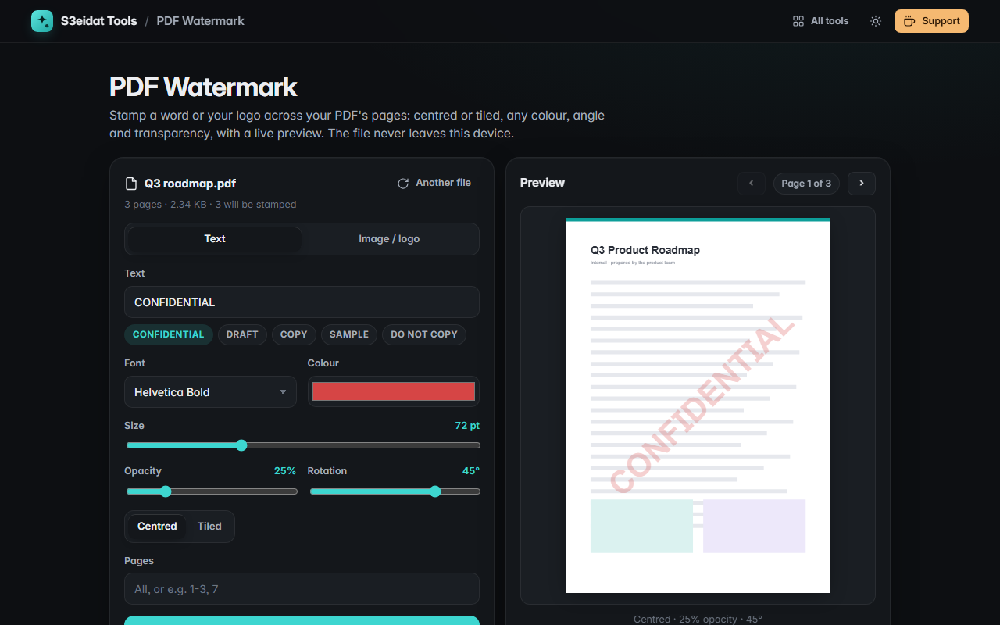

# PDF Watermark

> Stamp text or a logo on every PDF page: centred or tiled, any colour, angle and transparency, with a live preview. Free, private, and it runs entirely in your browser.

### ▶ [Open PDF Watermark](https://s3eidat.github.io/pdf-watermark/)



## Features

- **Text** watermarks with one-click presets (CONFIDENTIAL, DRAFT, COPY, SAMPLE, DO NOT COPY) or your own words
- **Image / logo** watermarks (PNG with transparency looks best), sized as a share of the page width
- Font, colour, size, **opacity**, **rotation** (-90° to 90°)
- **Centred** or **tiled** across the page, with adjustable spacing
- **Page range** like `1-3, 7`
- **Live preview** of any page
- Lands correctly on **rotated** and **odd-sized** pages; text watermarks are real PDF text
- Settings are remembered in your browser

## Limits

- A watermark is drawn on top of the page. Anyone with a PDF editor can still remove it; it deters copying, it doesn't prevent it.
- Text the standard PDF fonts can't draw (Arabic, for example) is stamped as a sharp image instead of text.
- Password-protected PDFs need their protection removed first.

## Privacy

Your PDF and your logo never leave your device. There is no server, no account, no analytics.
The page ships with a strict Content-Security-Policy (`connect-src 'self'`), so the browser
itself blocks any attempt to send data anywhere. Watermarks are added with [pdf-lib](https://github.com/Hopding/pdf-lib) (MIT)
and previewed with [pdf.js](https://github.com/mozilla/pdf.js) (Apache-2.0), both included in `lib/`.

## Run it yourself

It's plain HTML, CSS and JavaScript with no build step:

```bash
git clone https://github.com/s3eidat/pdf-watermark
cd pdf-watermark
python -m http.server 8000
```

Then open http://localhost:8000.

## Support

If this saved you time, **[buy me a coffee ☕](https://s3eidat.github.io/coffee/)**. It keeps every tool free.

---

Part of **[S3eidat Tools](https://s3eidat.github.io/)**: 100+ free, private tools that run in your browser. MIT licensed.
